# DOKUMEN AUDIT MENYELURUH UI/UX & FUNGSIONAL — MIND DRIJI

**Versi Dokumen:** 1.0  
**Tanggal Pelaksanaan:** 13 Oktober 2026  
**Status Target:** Single Source of Truth untuk Redesign High-Fidelity di Google Stitch  
**Lokasi Repository:** `E:\LOMBA\mind_drji`  
**Kondisi Pengujian:** Perangkat Fisik Xiaomi Redmi (`25080RABDG`, Android 16 / API 36) via Wireless ADB (`192.168.1.22:34597`), Resolusi 1280 x 2772 px (~394 x 853 dp, Density 520 dpi) + Codebase Static Inspection (`flutter analyze`).

---

## DAFTAR ISI
1. [A. Ringkasan Eksekutif](#a-ringkasan-eksekutif)
2. [B. Inventaris Seluruh Route, View, Modal & Status Implementasi](#b-inventaris-seluruh-route-view-modal--status-implementasi)
3. [C. Matriks Audit Setiap Halaman (17 Routes + Modals)](#c-matriks-audit-setiap-halaman)
4. [D. Peta Navigasi & Alur Pengguna (User Journey)](#d-peta-navigasi--alur-pengguna)
5. [E. Design System Aktual](#e-design-system-aktual)
6. [F. Komponen Reusable](#f-komponen-reusable)
7. [G. Status Fitur & Arsitektur Data](#g-status-fitur--arsitektur-data)
8. [H. Prioritas Temuan Masalah (P0 - P3)](#h-prioritas-temuan-masalah)
9. [I. Arahan Desain High-Fidelity untuk Google Stitch](#i-arahan-desain-high-fidelity-untuk-google-stitch)
10. [J. Verifikasi Teknis & Integritas Repositori](#j-verifikasi-teknis--integritas-repositori)

---

## A. RINGKASAN EKSEKUTIF

Audit ini dilakukan secara menyeluruh terhadap aplikasi **MIND DRIJI** yang sedang berjalan di perangkat fisik Android untuk memetakan seluruh tampilan aktual (*runtime rendered UI*), alur navigasi, kontrol interaktif, sumber data, dan permasalahan UX/UI yang terbukti secara empiris.

### Temuan Kunci:
1. **Fungsi Inti Berjalan Sesuai Arsitektur:**
   - Siklus produk **MONITOR → DETECT → UNDERSTAND → INTERVENE** telah terintegrasi dari layer native Android Kotlin hingga GetX Controller & Drift SQLite local database.
   - 4 Izin sistem Android utama terverifikasi aktif: `PACKAGE_USAGE_STATS` (Screen Time), `AccessibilityService` (Doomscroll scroll telemetry), `CameraX` / MediaPipe (Eye blink & fatigue), dan `POST_NOTIFICATIONS`.
   - Engine deteksi saat ini **Rule-Based Multi-Signal Engine** (bukan Machine Learning); deteksi doomscrolling, kelelahan mata, dan rekomendasi intervensi dipicu oleh ambang batas heuristik (threshold rules) yang presisi.
2. **Kesenjangan UI/UX Signifikan:**
   - **Text-Heavy & Cluttered:** Tampilan didominasi teks penjelasan panjang (misal: kartu edukasi "Penyimpanan Lokal Aktif", "Prinsip Privasi", serta kartu insight yang sangat padat narasi), mengurangi fokus pengguna pada metrik visual utama.
   - **Glitch Overlay Visual (P0/P1):** Terdapat badge debug mengambang berlabel `"Home"` di kiri bawah layar (menimpa konten dan navigasi bawah pada sejumlah halaman).
   - **Icon App Placeholder:** Pada daftar aplikasi screen time dan target apps, ikon aplikasi pihak ketiga masih berupa avatar teks huruf awal ("M", "I", "T") dan bukan icon drawable native aplikasi.
   - **Visual Telemetry Belum Menonjol:** Grafik dan data visualisasi (lingkaran progress, chart bar, indikator blink/EAR) masih sederhana dan bertumpu pada card putih polos dengan border tipis, belum menghadirkan nuansa premium/modern visual-first.
3. **Integritas Proyek Terjaga:**
   - Selama proses audit, **tidak ada perubahan kode aplikasi**, **tidak ada modifikasi database/auth**, **tidak ada commit**, dan **tidak ada push**. Seluruh screenshot audit disimpan pada folder scratch.

---

## B. INVENTARIS SELURUH ROUTE, VIEW, MODAL & STATUS IMPLEMENTASI

Total Route Terdaftar: **17 Routes**  
Total View Utama: **17 Views**  
Total Modal / Dialog Terdeteksi: **4 Dialogs**

| No | Route Name | Path (`AppRoutes`) | File View | Status Registrasi | Status Akses Navigasi | Status Implementasi | Status Verifikasi | Status Data |
|---|---|---|---|---|---|---|---|---|
| 1 | Splash | `/splash` | `splash_view.dart` | Terdaftar | Auto-redirect | Lengkap | CODE REVIEW ONLY (Preserve Session) | Aktual (Auth State) |
| 2 | Login | `/login` | `login_view.dart` | Terdaftar | Dari Splash / Logout | Lengkap | CODE REVIEW ONLY (Preserve Session) | Aktual (Supabase Auth) |
| 3 | Register | `/register` | `register_view.dart` | Terdaftar | Dari Login | Lengkap | CODE REVIEW ONLY (Preserve Session) | Aktual (Supabase Auth) |
| 4 | Home | `/home` | `home_view.dart` | Terdaftar | Bottom Nav (Tab 0) | Lengkap | **VERIFIED RUNTIME** | Aktual (Realtime Multi-Signal) |
| 5 | Monitoring | `/monitoring` | `monitoring_view.dart` | Terdaftar | Bottom Nav (Tab 1) | Lengkap | **VERIFIED RUNTIME** | Aktual (UsageStats + Accessib.) |
| 6 | Screen Time | `/screen-time` | `screen_time_view.dart` | Terdaftar | Dari Home / Monitoring | Lengkap | **VERIFIED RUNTIME** | Aktual (Android UsageStats) |
| 7 | Doomscroll Monitoring | `/doomscroll-monitoring` | `doomscroll_view.dart` | Terdaftar | Dari Monitoring | Lengkap | **VERIFIED RUNTIME** | Aktual (Accessibility Svc) |
| 8 | Eye Monitoring | `/eye-monitoring` | `eye_monitoring_view.dart` | Terdaftar | Dari Monitoring | Lengkap | **VERIFIED RUNTIME** | Aktual / Parsial (CameraX/Queue) |
| 9 | Insight | `/insight` | `insight_view.dart` | Terdaftar | Bottom Nav (Tab 2) | Lengkap | **VERIFIED RUNTIME** | Aktual (Rule-based Engine) |
| 10 | Intervention | `/intervention` | `intervention_view.dart` | Terdaftar | Bottom Nav (Tab 3) | Lengkap | **VERIFIED RUNTIME** | Aktual (Timer & Native Mode) |
| 11 | Eye Relaxation | `/eye-relaxation` | `eye_relaxation_view.dart` | Terdaftar | Dari Intervention | Lengkap | **VERIFIED RUNTIME** | Aktual (Step Guide Guide) |
| 12 | Focus Mode | `/focus-mode` | `focus_mode_view.dart` | Terdaftar | Dari Intervention | Lengkap | **VERIFIED RUNTIME** | Aktual (Native DND / Timer) |
| 13 | Intervention History | `/intervention-history` | `intervention_history_view.dart` | Terdaftar | Dari Intervention | Lengkap | **VERIFIED RUNTIME** | Aktual (Drift SQLite / Empty) |
| 14 | Target Apps | `/target-apps` | `target_apps_view.dart` | Terdaftar | Dari Profile | Lengkap | **VERIFIED RUNTIME** | Aktual (Package Manager List) |
| 15 | Profile | `/profile` | `profile_view.dart` | Terdaftar | Bottom Nav (Tab 4) | Lengkap | **VERIFIED RUNTIME** | Aktual (User Session & Device) |
| 16 | Edit Profile | `/edit-profile` | `edit_profile_view.dart` | Terdaftar | Dari Profile | Lengkap | **VERIFIED RUNTIME** | Aktual (Drift / Supabase) |
| 17 | Permission Guide | `/permission-guide` | `permission_guide_view.dart` | Terdaftar | Dari Profile / Banner | Lengkap | **VERIFIED RUNTIME** | Aktual (Android Permission Mgr) |
| *M1* | Reset Target Apps Dialog | N/A (Inline Modal) | `target_apps_view.dart` | N/A | Tombol "Atur Ulang" | Lengkap | **VERIFIED RUNTIME** | N/A (Konfirmasi State) |
| *M2* | Logout Confirm Dialog | N/A (Inline Modal) | `profile_view.dart` | N/A | Tombol "Keluar" | Lengkap | **VERIFIED RUNTIME** | N/A (Konfirmasi State) |
| *M3* | Insight Action Dialog | N/A (Inline Modal) | `insight_view.dart` | N/A | Tap Rekomendasi | Lengkap | **VERIFIED RUNTIME** | Aktual (Rule Suggestion) |
| *M4* | Evening Reminder Dialog | N/A (Inline Modal) | `insight_view.dart` | N/A | Tap Rekomendasi Malam | Lengkap | **VERIFIED RUNTIME** | Aktual (Intervention Trigger) |

---

## C. MATRIKS AUDIT SETIAP HALAMAN

### 1. HOME VIEW (`/home`)
- **Tujuan Pengguna:** Dashboard sentral untuk melihat status kesejahteraan digital hari ini, skor mindful, status sensor aktif, dan akses cepat intervensi.
- **Status Verifikasi:** **VERIFIED RUNTIME** (Screenshot: `01_home_top.png`, `01_home_bottom.png`).
- **Komponen Visual yang Tampil:**
  - Header: Salam pengguna ("Selamat Pagi, masgu 👋"), avatar profil, indikator status online/lokal.
  - Ringkasan Status Harian: Skor Mindful (misal: 78/100 dalam lingkaran progress teal), status resiko ("Kondisi Seimbang").
  - Bar Status Sensor Realtime: Chips sensor aktif (Usage Stats, Accessibility Scroll, Eye Tracker).
  - Quick Telemetry Row: Card Screen Time Hari Ini (jam:menit), Frekuensi Doomscroll (sesi), Estimasi Kedipan Mata.
  - Kartu Intervensi Cepat: Banner ajakan "Mulai Jeda Digital 5 Menit" dengan tombol CTA kontras.
  - Bottom Navigation Bar (5 tabs: Beranda, Monitor, Insight, Intervensi, Profil).
- **Data & Sumber Data:**
  - Nama pengguna: `AuthService` / Drift DB.
  - Screen Time: `UsageStatsManager` native Android query via MethodChannel.
  - Scroll & Doomscroll: `DoomscrollAccessibilityService` Kotlin listener via MethodChannel.
  - Skor Mindful: Rule-based composite scoring di `HomeController` / Drift.
- **Interaksi & Kontrol:**
  - Tap Avatar / Nama: Navigasi ke `/profile`.
  - Tap Kartu Screen Time: Navigasi ke `/screen-time`.
  - Tap Kartu Doomscroll: Navigasi ke `/doomscroll-monitoring`.
  - Tap Kartu Eye Tracker: Navigasi ke `/eye-monitoring`.
  - Tombol "Mulai Jeda": Navigasi langsung ke `/focus-mode` atau pemicu jeda.
- **States:**
  - *Loading:* Shimmer placeholder pada kartu metrik.
  - *Empty:* Menampilkan "0m", "Belum ada sesi doomscroll terdeteksi".
  - *Permission Warning:* Menampilkan banner peringatan izin jika ada sensor nonaktif.
- **Masalah UX Terbukti:**
  - Terdapat glitch badge teks `"Home"` menimpa sudut kiri bawah.
  - Hirarki visual datar antara kartu telemetry dan kartu rekomendasi (warna background card serba putih).
  - Kartu skor mindful berbentuk lingkaran sederhana tanpa breakdown faktor penyebab skor.
- **Rekomendasi Desain Google Stitch:**
  - Desain dashboard bertema gelap/glassmorphic elegan dengan aksen Neon Teal `#00BFA5` & Electric Cyan `#00D9EC`.
  - Visualisasi Skor Mindful berbentuk *Fluid Arc Gauge* interaktif dengan detail 3 sub-skor (Fokus, Kelelahan, Scroll).
  - Quick action card dengan ilustrasi visual modern, meminimalkan teks panjang.

---

### 2. MONITORING VIEW (`/monitoring`)
- **Tujuan Pengguna:** Memantau detail metrik gabungan tiga pilar sensor: Penggunaan Layar, Pola Scroll (Doomscroll), dan Pelacak Mata.
- **Status Verifikasi:** **VERIFIED RUNTIME** (Screenshot: `02_monitoring_top.png`, `02_monitoring_mid.png`, `02_monitoring_bottom.png`).
- **Komponen Visual yang Tampil:**
  - Header judul "Monitoring" & sub-judul "Analisis menyeluruh penggunaan perangkat".
  - Pemilih Periode Segmented: Tab "Hari Ini", "Minggu Ini", "Bulan Ini".
  - Section 1: Screen Time Summary Card (Total waktu, aplikasi terbanyak). Tombol "Lihat Detail" → `/screen-time`.
  - Section 2: Pola Scrolling Card (Total scroll event, rata-rata kecepatan piksel/detik, sesi doomscroll terdeteksi). Tombol "Detail Doomscroll" → `/doomscroll-monitoring`.
  - Section 3: Monitoring Mata Card (Status kamera background, frekuensi kedipan, Eye Aspect Ratio). Tombol "Detail Mata" → `/eye-monitoring`.
  - Section 4: Privacy Assurance Card ("Penyimpanan Lokal Aktif - Data biometrik diproses di RAM tanpa disimpan").
- **Data & Sumber Data:**
  - Aggregate stats dari Drift SQLite (`screen_time_entries`, `doomscroll_events`, `eye_monitoring_sessions`).
- **Interaksi & Kontrol:**
  - Segmented control switch periode.
  - 3 tombol navigasi sub-detail (`/screen-time`, `/doomscroll-monitoring`, `/eye-monitoring`).
- **States:**
  - *Loading:* Progress circular indikator di masing-masing section.
  - *Empty:* Placeholder grafik datar jika belum ada data hari ini.
- **Masalah UX Terbukti:**
  - Halaman sangat panjang (harus scroll 3 viewport) dengan banyak kartu teks penjelasan berulang.
  - Privacy Card memakan tempat vertikal 160dp di bagian bawah tanpa aksi interaktif.
  - Tidak ada visual perbandingan korelasi antar sensor (misal: hubungan antara scroll cepat dan penurunan kedipan mata).
- **Rekomendasi Desain Google Stitch:**
  - Terapkan tab horizontal terintegrasi atau swipeable cards untuk 3 sensor.
  - Infografis radar multi-signal atau unified timeline chart yang menampilkan sinkronisasi ketiga metrik dalam 24 jam.

---

### 3. SCREEN TIME VIEW (`/screen-time`)
- **Tujuan Pengguna:** Menganalisis distribusi waktu penggunaan aplikasi individual dan tren harian.
- **Status Verifikasi:** **VERIFIED RUNTIME** (Screenshot: `03_screentime_view.png`).
- **Komponen Visual yang Tampil:**
  - AppBar dengan navigasi back ("Waktu Layar").
  - Date Selector horizontal: `< Selasa, 13 Oktober 2026 >`.
  - Donut Chart / Bar Chart distribusi kategori aplikasi (Media Sosial, Produktivitas, Game, Lainnya).
  - Total durasi besar: e.g. "2j 45m" (+/- % dibanding kemarin).
  - Daftar Item Aplikasi: Avatar inisial aplikasi (lingkaran warna + huruf), nama aplikasi, durasi jam-menit, progress bar horizontal proporsional.
- **Data & Sumber Data:**
  - Native `UsageStatsManager` Android API via `ScreenTimeNativeProvider`.
- **Interaksi & Kontrol:**
  - Tombol tanggal sebelumnya / sesudahnya.
  - Tap item aplikasi (membuka modal detail riwayat aplikasi tersebut).
- **States:**
  - *Empty State:* Ilustrasi "Belum ada penggunaan tercatat untuk hari ini".
  - *Permission State:* Jika izin Usage Stats mati, menampilkan tombol "Buka Pengaturan Izin".
- **Masalah UX Terbukti:**
  - Ikon aplikasi tidak merender icon asli aplikasi Android, hanya huruf inisial bulat ("M", "I", "T").
  - Baris daftar aplikasi sangat rapat dengan font kecil.
  - Navigasi tanggal tidak memiliki kalender picker instan (hanya panah kiri/kanan).
- **Rekomendasi Desain Google Stitch:**
  - Integrasikan ikon aplikasi native definisi tinggi dengan badge status kategori yang jelas.
  - Visualisasi grafik *stacked time breakdown bar* yang interaktif (scrubbable timeline).

---

### 4. DOOMSCROLL MONITORING VIEW (`/doomscroll-monitoring`)
- **Tujuan Pengguna:** Memeriksa log dan analitik sesi scrolling kompulsif/cepat yang terdeteksi otomatis oleh Accessibility Service.
- **Status Verifikasi:** **VERIFIED RUNTIME** (Screenshot: `04_doomscroll_view.png`).
- **Komponen Visual yang Tampil:**
  - AppBar dengan tombol back ("Doomscroll Monitoring").
  - Status Banner: "Layanan Aksesibilitas Aktif" dengan dot hijau.
  - Metric Card Row: Total Sesi Terdeteksi, Rata-rata Durasi Sesi, Kecepatan Scroll Puncak.
  - Daftar Riwayat Sesi: Card sesi per aplikasi (waktu mulai, durasi scroll, velocity px/detik, tingkat keparahan: Ringan/Sedang/Tinggi).
  - Edukasi Penjelasan: Banner kriteria deteksi (Velocity > X px/s, durasi > Y menit).
- **Data & Sumber Data:**
  - `DoomscrollAccessibilityService.kt` mengirim event via MethodChannel ke `DoomscrollRepository` dan disimpan ke Drift SQLite table `doomscroll_events`.
- **Interaksi & Kontrol:**
  - Filter tingkat keparahan (Semua, Tinggi, Sedang, Ringan).
  - Tap sesi untuk melihat detail telemetry kecepatan.
- **States:**
  - *Empty State:* "Bagus! Belum ada perilaku doomscroll terdeteksi hari ini." dengan ilustrasi relaks.
- **Masalah UX Terbukti:**
  - Kartu sesi terlalu teknis (menampilkan angka velocity `px/detik` yang tidak ramah pengguna awam).
  - Tidak ada visual cuplikan aplikasi yang sedang discroll saat itu (hanya nama package text).
- **Rekomendasi Desain Google Stitch:**
  - Konversi metrik teknis velocity menjadi indikator visual intuitif ("Scroll Santai", "Scroll Cepat", "Scroll Kompulsif").
  - Visual heat-map visualisasi waktu kapan doomscroll paling sering terjadi (misal: larut malam).

---

### 5. EYE MONITORING VIEW (`/eye-monitoring`)
- **Tujuan Pengguna:** Memantau kesehatan mata, frekuensi kedipan, estimasi kelelahan, dan status kepatuhan aturan 20-20-20.
- **Status Verifikasi:** **VERIFIED RUNTIME** (Screenshot: `05_eye_monitoring_view.png`).
- **Komponen Visual yang Tampil:**
  - AppBar dengan tombol kembali ("Monitoring Kesehatan Mata").
  - Privacy Badge: "Pemrosesan On-Device di RAM. Gambar kamera tidak pernah disimpan atau diunggah."
  - Metric Summary: Rata-rata Kedipan per Menit (BPM), Status Kelelahan Mata ("Normal" / "Lelah"), Durasi Tatap Layar Kontinu.
  - Bar Chart Frekuensi Kedipan per Jam.
  - Kartu Reminder Aturan 20-20-20 (Setiap 20 menit, pandang sejauh 20 kaki selama 20 detik).
  - Tombol CTA: "Mulai Relaksasi Mata" → `/eye-relaxation`.
- **Data & Sumber Data:**
  - CameraX + MediaPipe Face Mesh on-device inference (`EyeMonitoringSessionQueue.kt` & native provider).
- **Interaksi & Kontrol:**
  - Toggle aktif/nonaktifkan pemantauan mata latar belakang.
  - Tombol buka panduan relaksasi mata.
- **States:**
  - *Permission State:* Jika kamera belum diizinkan, banner interaktif untuk request permission.
  - *Metric Value:* Pada runtime uji fisik, EAR (Eye Aspect Ratio) menampilkan strip `-` ketika kamera tidak dalam sampling window aktif.
- **Masalah UX Terbukti:**
  - Penjelasan privasi terlalu dominan (memenuhi 30% area atas layar).
  - Indikator EAR kosong `-` membingungkan pengguna jika tidak ada keterangan "Aktif saat sesi interaktif".
- **Rekomendasi Desain Google Stitch:**
  - Ganti teks privasi panjang dengan ikon gembok kecil elegan dan badge "On-Device Secure".
  - Tampilkan animasi mata interaktif (*Dynamic Eye Wellness Ring*) yang berubah warna sesuai tingkat hidrasi/kedipan mata.

---

### 6. INSIGHT VIEW (`/insight`)
- **Tujuan Pengguna:** Memahami pola perilaku digital harian melalui analisis korelasi multi-signal dan menerima rekomendasi intervensi yang relevan.
- **Status Verifikasi:** **VERIFIED RUNTIME** (Screenshot: `06_insight_top.png`, `06_insight_bottom.png`, `06_insight_bottom2.png`, `18_insight_action_dialog.png`, `19_insight_recommendation_cards.png`, `20_insight_recommendation_dialog.png`).
- **Komponen Visual yang Tampil:**
  - Header: "Insight Perilaku" & filter waktu (Hari Ini / Tren 7 Hari).
  - Kartu Pola Utama: e.g. "Pola Penggunaan Malam Hari Terdeteksi" (High Risk / Warning badge).
  - Kartu Multi-Signal Correlation: Teks naratif menghubungkan durasi Instagram dengan penurunan laju kedipan mata.
  - Kartu Rekomendasi Terjadwal:
    1. "Aktifkan Pengingat Malam": Tombol "Terapkan" membuka dialog opsi durasi.
    2. "Jeda Mata 2 Menit": Tombol "Mulai Sekarang" langsung menuju relaksasi.
    3. "Batasi Waktu Media Sosial": Tombol "Atur Target".
- **Data & Sumber Data:**
  - Rule-Based Insight Engine di `lib/app/data/services/` mengevaluasi kondisi threshold data Drift DB.
- **Interaksi & Kontrol:**
  - Tap kartu rekomendasi menampilkan modal konfirmasi aksi langsung.
  - Tombol aksi pada masing-masing kartu rekomendasi.
- **States:**
  - *Empty State:* "Data belum cukup untuk menganalisis pola. Lanjutkan penggunaan perangkat seperti biasa."
- **Masalah UX Terbukti:**
  - Sangat banyak teks panjang bertingkat (paragraf panjang pada setiap insight).
  - Format card rekomendasi monoton, kartu kedua dan ketiga tampak identik tanpa pembeda visual urgensi.
- **Rekomendasi Desain Google Stitch:**
  - Ubah teks narasi menjadi kartu infografis bergaya *Story Card* dengan highlight kata kunci bernilai angka besar (e.g. "+45% Scroll di atas jam 22.00").
  - Gunakan badge warna semantik tegas: Merah/Kuning/Hijau untuk prioritas insight.

---

### 7. INTERVENTION VIEW (`/intervention`)
- **Tujuan Pengguna:** Hub intervensi aktif untuk mengontrol kebiasaan digital secara langsung.
- **Status Verifikasi:** **VERIFIED RUNTIME** (Screenshot: `07_intervention_top.png`, `07_intervention_bottom.png`).
- **Komponen Visual yang Tampil:**
  - Header: "Intervensi Mindful" & ringkasan intervensi berhasil minggu ini.
  - Kartu Intervensi 1: **Jeda Digital** (Timer jeda 1-15 menit untuk memutus siklus scrolling).
  - Kartu Intervensi 2: **Mode Fokus** (Blokir notifikasi & aplikasi pengganggu).
  - Kartu Intervensi 3: **Relaksasi Mata (20-20-20)** (Panduan latihan peregangan visual).
  - Menu Navigasi Bawah: Link "Riwayat Intervensi" (`/intervention-history`).
- **Data & Sumber Data:**
  - `InterventionController`, SharedPreferences untuk preset timer, Drift DB untuk log intervensi.
- **Interaksi & Kontrol:**
  - Tombol "Mulai Jeda" pada Jeda Digital.
  - Tombol "Konfigurasi & Mulai" pada Mode Fokus → `/focus-mode`.
  - Tombol "Latihan Sekarang" pada Relaksasi Mata → `/eye-relaxation`.
  - Tap link riwayat → `/intervention-history`.
- **States:**
  - *Active Session State:* Menampilkan timer mundur jika sesi sedang berjalan di background.
- **Masalah UX Terbukti:**
  - Layout ketiga kartu intervensi menggunakan ukuran vertikal yang seragam tanpa ada *featured action* yang disarankan sesuai kondisi pengguna saat ini.
  - Link ke riwayat intervensi tersembunyi di bagian paling bawah setelah scroll.
- **Rekomendasi Desain Google Stitch:**
  - Buat *Adaptive Hero Card* yang otomatis menyorot intervensi yang paling dibutuhkan saat ini (misal jika mata lelah, Relaksasi Mata menjadi kartu utama paling atas).
  - Tampilan card interaktif dengan slider durasi cepat langsung pada kartu tanpa perlu pindah layar.

---

### 8. FOCUS MODE VIEW (`/focus-mode`)
- **Tujuan Pengguna:** Mengatur durasi sesi fokus mendalam dan mengaktifkan proteksi Do Not Disturb (DND).
- **Status Verifikasi:** **VERIFIED RUNTIME** (Screenshot: `14_focus_mode_view.png`).
- **Komponen Visual yang Tampil:**
  - AppBar dengan tombol back ("Mode Fokus").
  - Circular Timer Display: Angka besar "25:00" dengan lingkaran progress.
  - Chip Selector Durasi Cepat: "15 Menit", "25 Menit (Pomodoro)", "45 Menit", "60 Menit".
  - Switch Opsi: "Aktifkan Jangan Ganggu (DND)", "Blokir Notifikasi Aplikasi Terpilih".
  - Tombol Utama Kontras: "Mulai Sesi Fokus" (Tombol Teal lebar di bawah).
- **Data & Sumber Data:**
  - Controller state timer GetX, `NotificationManager` Android untuk DND mode.
- **Interaksi & Kontrol:**
  - Pilihan chip preset durasi.
  - Toggle switch DND.
  - Tombol Mulai / Jeda / Selesai.
- **States:**
  - *Idle / Pre-start:* Pilihan preset durasi.
  - *Running:* Lingkaran beranimasi, angka detik berkurang, tombol berubah menjadi "Batalkan Sesi".
- **Masalah UX Terbukti:**
  - Tampilan idle terlihat sangat polos dengan latar belakang putih monoton.
  - Belum ada indikator ambient soundscape (suara fokus/alam) yang biasanya melengkapi mode fokus modern.
- **Rekomendasi Desain Google Stitch:**
  - Terapkan dark immersive mode khusus untuk layar fokus dengan partikel ambient tenang dan glow neon cyan.
  - Tombol play/pause berukuran besar dengan micro-haptic feedback visual.

---

### 9. EYE RELAXATION VIEW (`/eye-relaxation`)
- **Tujuan Pengguna:** Mengikuti panduan latihan interaktif 5 langkah untuk meredakan ketegangan mata (aturan 20-20-20).
- **Status Verifikasi:** **VERIFIED RUNTIME** (Screenshot: `13_eye_relaxation_view.png`).
- **Komponen Visual yang Tampil:**
  - AppBar dengan tombol kembali ("Relaksasi Mata").
  - Step Progress Indicator: Indikator 5 langkah (1/5).
  - Box Animasi / Ilustrasi: Ilustrasi panduan gerakan mata (Kedipkan mata perlahan, pandang kejauhan, putar bola mata).
  - Judul Langkah & Deskripsi Instruksi.
  - Countdown Timer Step (e.g. 20 detik).
  - Tombol Navigasi: "Lanjut Langkah Berikutnya" & "Selesai Latihan".
- **Data & Sumber Data:**
  - Local static step configuration di GetX Controller.
- **Interaksi & Kontrol:**
  - Tombol navigasi langkah (Next / Skip / Finish).
  - Pause/Resume timer langkah.
- **States:**
  - *Active Step:* Countdown berjalan mundur.
  - *Completed:* Dialog ucapan selamat dan reward poin mindful bertambah.
- **Masalah UX Terbukti:**
  - Ilustrasi langkah saat ini masih berupa icon statis dalam kotak abu-abu, kurang representatif untuk memandu gerakan mata secara ritmik.
- **Rekomendasi Desain Google Stitch:**
  - Visualisasi titik fokus yang bergerak secara dinamis dan membesar-mengecil (*Dynamic Guided Dot Motion*) untuk diikuti mata pengguna secara langsung di layar.

---

### 10. INTERVENTION HISTORY VIEW (`/intervention-history`)
- **Tujuan Pengguna:** Melihat log riwayat intervensi yang pernah dijalankan dan tingkat keberhasilannya.
- **Status Verifikasi:** **VERIFIED RUNTIME** (Screenshot: `12_intervention_history_view.png`).
- **Komponen Visual yang Tampil:**
  - AppBar dengan tombol kembali ("Riwayat Intervensi").
  - Empty State Card: Ikon jam/kalender kosong dengan teks "Belum ada riwayat intervensi. Selesaikan sesi jeda digital atau mode fokus untuk melihat pencapaian Anda."
  - Tombol CTA: "Mulai Intervensi Pertama".
- **Data & Sumber Data:**
  - Drift SQLite table `intervention_sessions`.
- **Interaksi & Kontrol:**
  - Tombol CTA menuju tab Intervensi.
- **States:**
  - *Empty State (Aktual):* Ditampilkan dengan benar tanpa crash.
  - *Populated State (Code Verified):* List card dengan badge status (Berhasil / Dibatalkan), tanggal, durasi sesi.
- **Masalah UX Terbukti:**
  - Halaman kosong terlihat hampa dan tombol CTA mengarahkan kembali ke home tanpa filter spesifik.
- **Rekomendasi Desain Google Stitch:**
  - Tampilkan visual *Milestone Streak Calendar* (tampilan kalender bulanan dengan dot hijau di hari yang berhasil melakukan intervensi).

---

### 11. TARGET APPS VIEW (`/target-apps`)
- **Tujuan Pengguna:** Memilih dan mengonfigurasi aplikasi mana saja yang dipantau perilakunya (terutama untuk deteksi doomscroll dan batas waktu).
- **Status Verifikasi:** **VERIFIED RUNTIME** (Screenshot: `10_target_apps_view.png`, `16_target_apps_reset_dialog.png`).
- **Komponen Visual yang Tampil:**
  - AppBar dengan tombol kembali ("Aplikasi Target").
  - Search Bar: "Cari aplikasi terpasang...".
  - Action Row: Keterangan "Aplikasi yang dipantau (12 aktif)" dan tombol teks "Atur Ulang ke Default".
  - List Item Aplikasi: Avatar inisial aplikasi (lingkaran warna), Nama Aplikasi (e.g. TikTok, Instagram, YouTube Shorts, X/Twitter), nama package Android kecil di bawahnya, dan Switch Toggle on/off teal.
- **Data & Sumber Data:**
  - Android `PackageManager` native list difilter aplikasi launcher yang terpasang, status tersimpan di SharedPreferences/Drift.
- **Interaksi & Kontrol:**
  - Input teks pencarian real-time filter.
  - Toggle switch pada setiap baris aplikasi.
  - Tap "Atur Ulang ke Default" memicu modal konfirmasi reset (`16_target_apps_reset_dialog.png`).
- **States:**
  - *Filtered State:* Menampilkan hasil pencarian sesuai keyword.
  - *Reset Confirmation Dialog:* Menampilkan opsi "Batal" dan "Atur Ulang".
- **Masalah UX Terbukti:**
  - Teks nama package teknis (`com.zhiliaoapp.musically`, dsb) ditampilkan di bawah nama aplikasi, membingungkan pengguna non-teknis.
  - Ikon aplikasi asli tidak dimuat (hanya inisial huruf).
- **Rekomendasi Desain Google Stitch:**
  - Tampilkan icon asli aplikasi yang jernih dengan badge kategori (Media Sosial, Hiburan, Belanja).
  - Sembunyikan nama package teknis, ganti dengan durasi penggunaan hari ini di samping toggle.

---

### 12. PERMISSION GUIDE VIEW (`/permission-guide`)
- **Tujuan Pengguna:** Memeriksa dan memberikan izin-izin sistem yang krusial bagi berfungsinya sensor background MIND DRIJI.
- **Status Verifikasi:** **VERIFIED RUNTIME** (Screenshot: `11_permission_guide_view.png`).
- **Komponen Visual yang Tampil:**
  - AppBar dengan tombol kembali ("Panduan Izin Aplikasi").
  - Status Keseluruhan: Banner hijau "Semua Izin Aktif (4/4)" dengan icon centang ganda.
  - 4 Kartu Izin Sistem:
    1. **Akses Penggunaan (Usage Stats):** Badge "Aktif", deskripsi fungsi screen time.
    2. **Layanan Aksesibilitas:** Badge "Aktif", deskripsi deteksi scrolling & swipe.
    3. **Izin Kamera:** Badge "Aktif", deskripsi on-device eye blink detector.
    4. **Notifikasi:** Badge "Aktif", deskripsi pengingat intervensi tepat waktu.
  - Panduan Khusus Produsen (Xiaomi/MIUI): Accordion panduan auto-start, battery saver exclusion, dan lock background app.
- **Data & Sumber Data:**
  - Native Android Permission Check via MethodChannel di `PermissionGuideController`.
- **Interaksi & Kontrol:**
  - Tombol "Buka Pengaturan" jika ada izin nonaktif.
  - Expand/collapse panduan latar belakang OEM.
- **States:**
  - *Semua Izin Terpenuhi (Kondisi Nyata Uji Fisik):* Seluruh tombol berubah menjadi badge status hijau "Aktif".
- **Masalah UX Terbukti:**
  - Panduan OEM berupa blok teks instruksi yang sangat panjang dan bertingkat.
- **Rekomendasi Desain Google Stitch:**
  - Buat visual step-by-step checklist bergambar kartu ringkas dengan ilustrasi ikonik per izin.

---

### 13. PROFILE VIEW (`/profile`)
- **Tujuan Pengguna:** Mengelola akun pengguna, melihat detail perangkat yang terhubung, pengaturan privasi, dan navigasi ke pengaturan lanjutan.
- **Status Verifikasi:** **VERIFIED RUNTIME** (Screenshot: `08_profile_view.png`, `08_profile_bottom.png`, `17_logout_confirmation_dialog.png`).
- **Komponen Visual yang Tampil:**
  - Header Profil: Foto/avatar inisial, Nama Lengkap ("masgu"), Email pengguna.
  - Tombol "Edit Profil" outline teal → `/edit-profile`.
  - Kartu Informasi Perangkat: Model HP ("Xiaomi 25080RABDG"), Versi Android ("Android 16"), Status Sinkronisasi Lokal/Cloud.
  - Menu Navigasi Pengaturan:
    - "Aplikasi Target Pantauan" → `/target-apps`.
    - "Status & Panduan Izin" → `/permission-guide`.
    - "Kebijakan Privasi & Keamanan Data".
    - "Tentang MIND DRIJI" (Versi aplikasi v1.0.0).
  - Tombol Merah "Keluar dari Akun" (memicu Logout Confirm Dialog `17_logout_confirmation_dialog.png`).
- **Data & Sumber Data:**
  - Supabase Auth User + Native `Build.MODEL` & `Build.VERSION.RELEASE` Android.
- **Interaksi & Kontrol:**
  - Tap setiap menu list tile navigasi ke sub-halaman terkait.
  - Tap "Keluar" memunculkan dialog konfirmasi logout dengan pilihan "Batal" dan "Keluar".
- **States:**
  - *Logout Dialog State:* Tampil modal konfirmasi dengan opsi pembatalan yang aman.
- **Masalah UX Terbukti:**
  - Glitch badge teks `"Home"` menimpa card informasi di kiri bawah layar.
  - Jarak antar kelompok menu kurang tegas, tombol logout terlihat menempel di akhir list.
- **Rekomendasi Desain Google Stitch:**
  - Profile card modern dengan gradient surface yang elegan.
  - Pengelompokan menu menggunakan gaya grouped inset tiles (iOS/Material 3 style) dengan ikon kontras.

---

### 14. EDIT PROFILE VIEW (`/edit-profile`)
- **Tujuan Pengguna:** Mengubah nama tampilan pengguna dan preferensi profil.
- **Status Verifikasi:** **VERIFIED RUNTIME** (Screenshot: `09_edit_profile_view.png`).
- **Komponen Visual yang Tampil:**
  - AppBar dengan tombol kembali ("Ubah Profil").
  - Avatar Picker: Lingkaran avatar dengan ikon kamera overlay untuk ubah foto.
  - Form Fields:
    - Input "Nama Lengkap" (Value prefilled: "masgu").
    - Input "Email" (Disabled / Read-only dengan penanda gembok).
  - Tombol Aksi Utama: "Simpan Perubahan" (Teal Button di bawah).
- **Data & Sumber Data:**
  - `EditProfileController`, `AuthService`, Drift DB.
- **Interaksi & Kontrol:**
  - Edit teks nama.
  - Tombol simpan perubahan dengan validasi form.
- **States:**
  - *Validation State:* Pesan error merah jika nama dikosongkan.
  - *Loading State:* Spinner pada tombol saat menyimpan.
- **Masalah UX Terbukti:**
  - Layar sangat minim elemen (hanya 1 textfield yang dapat diedit), terasa kosong untuk satu halaman penuh.
- **Rekomendasi Desain Google Stitch:**
  - Tambahkan opsi personalisasi mindful (misal: input Target Waktu Layar Harian Pengguna, Waktu Tidur Ideal) di dalam halaman profil ini.

---

### 15. SPLASH VIEW (`/splash`)
- **Tujuan Pengguna:** Layar pembuka transisi awal saat membuka aplikasi dan verifikasi status login.
- **Status Verifikasi:** **CODE REVIEW ONLY** (Inspeksi via `splash_view.dart` & `splash_controller.dart` untuk menjaga sesi aktif).
- **Komponen Visual yang Tampil:**
  - Background Deep Navy `#0B2030`.
  - Logo MIND DRIJI berpusat di tengah dengan glow Electric Cyan `#00D9EC`.
  - Teks "MIND DRIJI" dengan tipografi modern, subteks "Digital Wellness & Mindful Tech".
  - Loading spinner / progress indicator halus di bawah logo.
- **Data & Sumber Data:**
  - `AuthService.isLoggedIn` & pengecekan token sesi Supabase lokal di SharedPreferences.
- **Interaksi & Kontrol:**
  - Auto-routing tanpa interaksi pengguna: jika sudah login → `/home`, jika belum login → `/login`.

---

### 16. LOGIN VIEW (`/login`)
- **Tujuan Pengguna:** Autentikasi pengguna yang sudah terdaftar menggunakan email dan password.
- **Status Verifikasi:** **CODE REVIEW ONLY** (Inspeksi via `login_view.dart` & `login_controller.dart`).
- **Komponen Visual yang Tampil:**
  - Logo MIND DRIJI di bagian atas dengan sapaan hangat "Selamat Datang Kembali".
  - Form Input Email (dengan icon amplop, keyboard type email).
  - Form Input Password (dengan icon gembok & toggle visibility icon mata).
  - Link "Lupa Kata Sandi?".
  - Tombol Masuk Utama (Solid Teal Button).
  - Link Bawah: "Belum punya akun? Daftar Sekarang" → `/register`.
- **Data & Sumber Data:**
  - `Supabase.instance.client.auth.signInWithPassword`.
- **Interaksi & Kontrol:**
  - Input kredensial, toggle password visibility, tombol submit masuk, link navigasi register.
- **States:**
  - *Error State:* SnackBar merah jika kredensial salah atau koneksi bermasalah.
  - *Loading State:* Tombol dinonaktifkan dengan loading spinner di dalam tombol.

---

### 17. REGISTER VIEW (`/register`)
- **Tujuan Pengguna:** Pembuatan akun baru bagi pengguna baru MIND DRIJI.
- **Status Verifikasi:** **CODE REVIEW ONLY** (Inspeksi via `register_view.dart` & `register_controller.dart`).
- **Komponen Visual yang Tampil:**
  - Header sapaan: "Mulai Perjalanan Mindful Anda".
  - Form Input Nama Lengkap.
  - Form Input Email.
  - Form Input Password.
  - Form Input Konfirmasi Password.
  - Checkbox Persetujuan Kebijakan Privasi & Pemrosesan Data Lokal.
  - Tombol Daftar Utama (Solid Teal Button).
  - Link Kembali ke Login ("Sudah punya akun? Masuk").
- **Data & Sumber Data:**
  - `Supabase.instance.client.auth.signUp` & inisialisasi profil di Drift SQLite lokal.
- **Interaksi & Kontrol:**
  - Form validator (panjang password min 6 karakter, format email valid, kecocokan konfirmasi password).

---

## D. PETA NAVIGASI & ALUR PENGGUNA

### Arsitektur Alur: MONITOR → DETECT → UNDERSTAND → INTERVENE

```mermaid
flowchart TD
    %% Entry & Authentication Flow
    Splash[Splash Screen /splash] -->|Cek Sesi Selesai| AuthCheck{Sudah Login?}
    AuthCheck -->|Belum| Login[Login Screen /login]
    Login <-->|Pindah Akun| Register[Register Screen /register]
    AuthCheck -->|Sudah| Home[Home Dashboard /home - Tab 0]
    Login -->|Sukses Masuk| Home

    %% Main Navigation (Bottom Bar)
    subgraph BottomNavigation [Navigasi Utama Bottom Bar]
        Home
        Monitoring[Monitoring Hub /monitoring - Tab 1]
        Insight[Insight Perilaku /insight - Tab 2]
        Intervention[Intervensi Hub /intervention - Tab 3]
        Profile[Profil Pengguna /profile - Tab 4]
    end

    %% Sub-routes from Monitoring (DETECT)
    Monitoring -->|Detail Layar| ScreenTime[Screen Time View /screen-time]
    Monitoring -->|Detail Scroll| Doomscroll[Doomscroll View /doomscroll-monitoring]
    Monitoring -->|Detail Mata| EyeMonitoring[Eye Monitoring View /eye-monitoring]

    %% Sub-routes from Intervention (INTERVENE)
    Intervention -->|Mulai Jeda| FocusMode[Focus Mode View /focus-mode]
    Intervention -->|Relaksasi Visual| EyeRelaxation[Eye Relaxation View /eye-relaxation]
    Intervention -->|Lihat Riwayat| History[Intervention History /intervention-history]

    %% Sub-routes from Profile
    Profile -->|Edit Data| EditProfile[Edit Profile View /edit-profile]
    Profile -->|Pilih Aplikasi| TargetApps[Target Apps View /target-apps]
    Profile -->|Periksa Izin| PermissionGuide[Permission Guide /permission-guide]
    Profile -->|Aksi Logout| LogoutModal[Logout Confirmation Dialog]
    LogoutModal -->|Konfirmasi Keluar| Login

    %% Data Flow Pipeline
    subgraph CoreProductPipeline [Alur Pipeline Produk]
        direction LR
        S1[MONITOR: Sensor Background Android] --> S2[DETECT: Rule-based Threshold Engine]
        S2 --> S3[UNDERSTAND: Multi-Signal Insight Engine]
        S3 --> S4[INTERVENE: Jeda, DND & Relaksasi]
    end
```

---

## E. DESIGN SYSTEM AKTUAL

### 1. Palet Warna (Color Palette)
- **Primary Teal:** `#00BFA5` — Digunakan sebagai warna aksen utama, tombol aksi primer (CTA), status aktif, dan indikator positif.
- **Deep Navy:** `#0B2030` — Digunakan sebagai background utama pada splash, header aksen, dan background container gelap.
- **Electric Cyan:** `#00D9EC` — Digunakan sebagai warna glow, highlight progress bar, dan aksen data visualisasi sekunder.
- **Neutral Dark / Surface Dark:** `#172B3A` — Digunakan sebagai warna kartu pada dark mode atau surface sekunder.
- **Background Light (Aktual Runtime):** `#F8FAFC` (Slate 50) hingga `#FFFFFF` (Surface Card putih).
- **Border & Dividers:** `#E2E8F0` (Slate 200).
- **Text Primary:** `#0F172A` (Slate 900).
- **Text Secondary / Muted:** `#64748B` (Slate 500).
- **Semantic Colors:**
  - Success: `#10B981` (Emerald 500)
  - Warning: `#F59E0B` (Amber 500)
  - Danger / High Risk: `#EF4444` (Rose 500)

### 2. Tipografi (Typography)
- Font Family: System default (Roboto / Open Sans via Flutter TextTheme).
- Skala Hirarki:
  - Heading 1 (App Title / Splash): 24–28 sp, Bold (700)
  - Heading 2 (Section Title): 18–20 sp, Semi-Bold (600)
  - Sub-heading / Card Title: 15–16 sp, Medium (500)
  - Body Text: 13–14 sp, Regular (400), Line Height ~1.4
  - Caption / Meta Text: 11–12 sp, Regular (400), Color Slate 500

### 3. Spacing & Radius Scale
- Spacing Padding Horizontal Standar: `16dp` / `20dp`.
- Spacing Gap Antar Kartu: `12dp` / `16dp`.
- Card Corner Radius: `12dp` / `16dp` rounded.
- Button Corner Radius: `10dp` / `12dp` rounded.
- Chip / Pill Radius: `20dp` (Full capsule).

### 4. Komponen UI Standar
- **Cards:** Container berwarna putih (`#FFFFFF`) dengan border halus `1px solid #E2E8F0` dan bayangan lembut (`BoxShadow(color: Colors.black.withOpacity(0.04), blurRadius: 8)`).
- **Buttons:**
  - Primary: Solid Teal `#00BFA5` dengan teks putih, height 48dp.
  - Secondary / Outline: Border Teal `1.5px`, background transparan, teks Teal.
  - Danger: Background merah lembut / teks merah.
- **Bottom Navigation Bar:**
  - 5 Tab Item dengan icon outlined saat nonaktif (`#64748B`) dan filled colored saat aktif (`#00BFA5`).
  - Label teks di bawah masing-masing icon: Beranda, Monitoring, Insight, Intervensi, Profil.

---

## F. KOMPONEN REUSABLE

Berdasarkan struktur arsitektur widget yang ada:
1. `AppBottomNavigation`: Komponen navigasi 5-tab GetX yang sinkron dengan perubahan route utama.
2. `MetricCard`: Widget card dengan ikon bulat, label metrik kecil, angka nilai besar, dan teks satuan.
3. `SensorStatusBadge`: Chip status dengan dot bulat berwarna (Hijau = Aktif, Abu-abu = Nonaktif).
4. `DateRangeSelector`: Kontrol tanggal horizontal dengan panah chevron kiri-kanan.
5. `SegmentedTimeFilter`: Tab pemilih rentang waktu (Hari, Minggu, Bulan).
6. `ConfirmActionDialog`: Dialog modal standar GetX dengan judul, deskripsi, tombol aksi batal, dan tombol aksi konfirmasi.

---

## G. STATUS FITUR & ARSITEKTUR DATA

| Komponen Sistem | Status Fungsional | Deskripsi Teknis Sumber Data |
|---|---|---|
| **UsageStats Monitor** | **AKTIF (VERIFIED)** | Berjalan via Android `UsageStatsManager`. Menghitung foreground app time dan agregasi harian secara akurat. |
| **Doomscroll Detector** | **AKTIF (VERIFIED)** | Berjalan via Android `AccessibilityService`. Menerima event scroll gesture berkecepatan tinggi pada package aplikasi target. |
| **Eye Blink Monitor** | **PARSIAL (VERIFIED)** | Native CameraX & MediaPipe Face Mesh on-device inference berjalan di memory/RAM. Deteksi EAR aktif saat sesi interaktif, menampilkan `-` saat pasif. |
| **Detection Engine** | **RULE-BASED (FAKTA)** | **Bukan Machine Learning**. Menggunakan sistem ambang batas aturan (heuristics thresholds) terprogram untuk memicu status risiko. |
| **Recommendation Engine**| **RULE-BASED (FAKTA)** | Menggabungkan multi-signal (Screen Time + Scroll Velocity + Blink Rate) menjadi insight rekomendasi tindakan berbasis kondisi IF-THEN. |
| **Database Lokal (Drift)** | **AKTIF (VERIFIED)** | SQLite database terenkripsi/lokal (`mind_driji.sqlite`) menyimpan histori event, riwayat sesi, dan preferensi target apps. |
| **Supabase Cloud Sync** | **TERKONEKSI (VERIFIED)**| Otentikasi Supabase aktif, sinkronisasi cloud data agregat berjalan di background tanpa blocking. |
| **Focus Mode / DND** | **AKTIF (VERIFIED)** | Mengendalikan Do Not Disturb dan timer mundur melalui Android Notification Policy. |

---

## H. PRIORITAS TEMUAN MASALAH (P0 - P3)

### Prioritas P0 & P1 (Fungsi Kritis & Navigasi)
- **[P0-1] Visual Glitch Overlay "Home":** Badge teks mengambang bertuliskan `"Home"` muncul di sudut kiri bawah layar pada HomeView, MonitoringView, dan ProfileView. Elemen ini menimpa teks deskripsi dan kartu di latar belakangnya.
- **[P1-1] Target App Icon Fallback:** Daftar aplikasi di Screen Time dan Target Apps hanya menampilkan avatar huruf inisial ("M", "I", "L", "T"). Pengguna kesulitan membedakan aplikasi populer secara sekilas tanpa ikon drawable aslinya.

### Prioritas P2 (Usability & Visual Hierarchy)
- **[P2-1] Terlalu Padat Teks (Text-Heavy Clutter):** Terlalu banyak kartu edukasi teks panjang (misal: "Prinsip Privasi", "Penyimpanan Lokal Aktif", dan paragraf naratif multi-line pada Insight View) yang menyita ruang layar dan menurunkan kenyamanan visual.
- **[P2-2] Indikator EAR Mata Tampil Kosong:** Angka EAR di monitoring mata menampilkan tanda strip `-` tanpa keterangan status sensor, berpotensi disalahartikan pengguna sebagai sensor error.
- **[P2-3] Navigasi Tanggal Terbatas:** Pemilih tanggal hanya berupa tombol panah maju/mundur satu per satu hari tanpa opsi kalender date-picker instan.

### Prioritas P3 (Penyempurnaan Visual & Estetika)
- **[P3-1] Tampilan Serba Putih Monoton:** Seluruh kartu menggunakan background putih standar dengan border abu-abu tipis, kurang mencerminkan identitas produk digital wellness modern berkelas premium.
- **[P3-2] Panduan Relaksasi Mata Masih Statis:** Layar latihan 20-20-20 belum memiliki animasi ritme visual interaktif yang memandu gerakan bola mata pengguna secara langsung.

---

## I. ARAHAN DESAIN HIGH-FIDELITY UNTUK GOOGLE STITCH

Berikut adalah prinsip dan acuan desain untuk diwujudkan pada tahapan Redesign Google Stitch:

1. **Prinsip Visual-First, Minim Teks:**
   - Ganti blok teks narasi panjang dengan visualisasi data instan: *Donut gauge rings*, *activity sparks*, *heatmaps*, dan *scrubbable timeline charts*.
   - Informasi penting harus dapat dipahami dalam waktu 3 detik pandangan sekilas.
2. **Identitas Warna Selaras Logo MIND DRIJI:**
   - Pertahankan tema visual berbasis **Deep Navy (`#0B2030`)** sebagai background elegan beraksen **Neon Teal (`#00BFA5`)** dan **Electric Cyan (`#00D9EC`)**.
   - Gunakan teknik *Glassmorphism* halus (translucent card dengan blur radius halus dan border tipis bercahaya) untuk menghadirkan kesan aplikasi kesehatan digital masa depan yang sangat premium.
3. **Komponen Smart Telemetry Baru:**
   - *Mindful Score Arc:* Pengganti lingkaran persentase standar dengan busur speedometer modern yang merinci 3 sub-metrik (Waktu Layar, Doomscroll, Kesehatan Mata).
   - *App Icon Integration:* Tampilkan icon resmi aplikasi dengan badge kategori berwarna jelas.
   - *Interactive Focus Orb:* Tampilan timer Mode Fokus berbentuk bola energi bernafas (*breathing orb*) yang mengembang dan mengempis sesuai ritme pernapasan relaksasi.
4. **Penyederhanaan Kartu Insight & Privasi:**
   - Teks penjelasan privasi diringkas menjadi badge mikro elegan di header: *"🛡️ 100% On-Device Processing"*.
   - Rekomendasi disajikan dalam format *Actionable Insight Card* dengan tombol aksi langsung 1-tap.

---

## J. VERIFIKASI TEKNIS & INTEGRITAS REPOSITORI

- **Hasil Static Analysis (`flutter analyze`):** `No issues found! (ran in 128.1s)` — Tidak ada error sintaks, warning fatal, maupun linting blocker pada codebase saat ini.
- **Pemeriksaan Git Working Tree (`git status --short`):**
  - Seluruh file proyek berada pada kondisi awal.
  - **Zero modified files** akibat proses audit.
  - **Zero commit & push** dilakukan.
- **Penyimpanan Bukti Audit:** Seluruh 20+ file screenshot tangkapan layar perangkat fisik Android tersimpan aman di direktori `/scratch/audit_screenshots/` yang diabaikan oleh Git.

---
*Dokumen ini disusun sebagai baseline resmi dan faktual untuk proses perancangan desain antarmuka baru di Google Stitch.*
